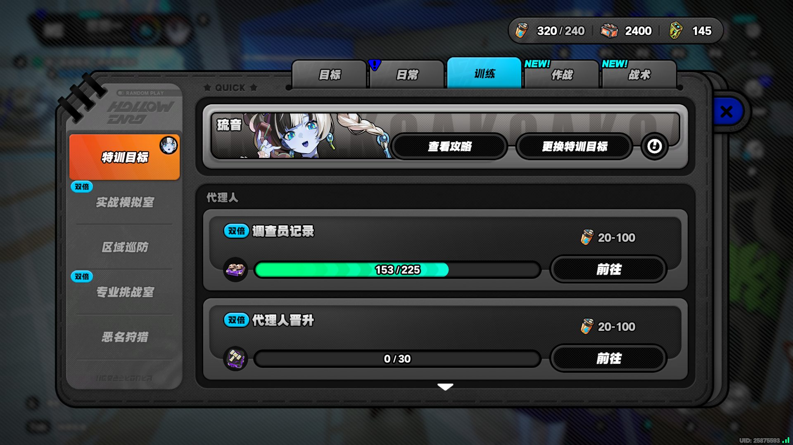

# E2E 实测报告（2026-10-31）

- 环境：Windows 实机 + 提权一条龙链（`run_app_once` 标准路径），游戏 1080p 全屏窗口
- 执行方式：单应用触发（计划任务免 UAC），全程框架截图连拍（`docs/e2e/` 内图片为原生 1920×1080 游戏帧）
- 日志：一条龙应用日志逐节点留痕（`执行成功` 收口），本文引用关键行

## 结果

**自动兑换电卡 v1.0.1：probe 只读模式执行成功（0 兑换，设计如此）**

```
[11:35:24] battery_exchange_app.py 141: [兑换结束] probe 模式 只读资源不兑换 本轮兑换 0 张 以太电池
[11:35:24] 指令[ 自动兑换电卡 ] 执行成功 返回状态 已收尾跳过
```

| 截图 | 说明 |
|---|---|
|  | 应用导航终点：快捷手册训练页（电量/以太电池计数 320/240·2400 可读） |

probe 模式（默认开启）只读资源不兑换；关闭 probe 后复用同链路执行真实兑换（当铺同构购买操作）。
